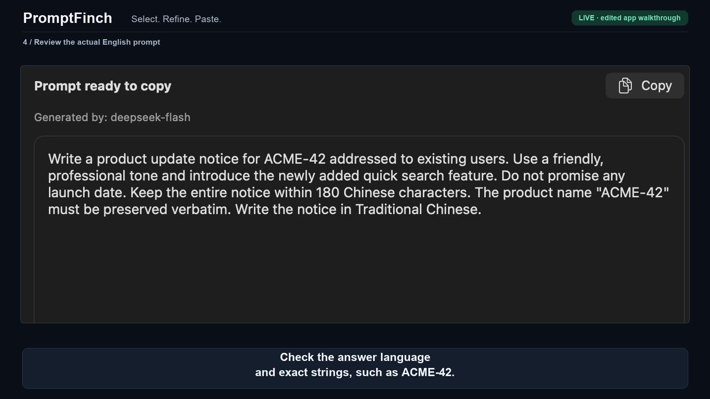

# PromptFinch 示範影片製作指南

本文件提供較完整的 90 秒錄製腳本、製作步驟與 README 嵌入範例。另已完成下述 72 秒手動工作台版本。文末的託管網址仍是模板，與已完成的影片連結分開列示。

## 已完成的 72 秒版本

[](media/promptfinch-demo.mp4)

[MP4 影片](media/promptfinch-demo.mp4) · [GIF 預覽](media/demo.gif) · [英文字幕](media/demo.en.srt) · [繁體中文字幕](media/demo.zh-TW.srt) · [製作紀錄](media/demo-script.md)

此版為 1920×1080、30 fps 的 H.264 MP4，沒有旁白，內嵌英文字幕；繁體中文字幕另附 SRT 檔。影片採用實際原生 App 畫面，包含合成中文需求、Writing 用途、Claude 下游模型提示、`deepseek-flash` 真實生成結果、獨立優化說明、複製成功訊息、貼入 TextEdit 測試文件，以及四種介面語言。

這是擷取畫面組成的剪輯導覽，不是連續螢幕錄影，也不呈現完整載入過程或生成耗時。自動化未能可靠錄到右鍵附加選單，因此此版沒有右鍵與 IDE 選取／貼回片段。下方 90 秒腳本保留這些內容作為後續實際錄影的目標，不能視為現有影片已收錄的功能。

## 影片定位

以 macOS App 的實際操作呈現「貼上需求 → 整理英文指令 → 檢視 → 複製貼上」，再展示 Codex 或 Claude 中已實測可讀取的選取文字入口。主片約 90 秒，採英文介面；旁白可以使用繁體中文，另加英文字幕，方便 GitHub 讀者觀看。影片可無旁白，但操作步驟仍需字幕說明。

瀏覽器工作台與 HTTP API 可在片尾文字提及，不必在主片重複示範。App 有四種介面語言；README 的其他文件語言不代表 App 也支援那些介面語言。

## 合成示範需求

使用以下內容，不需要真實客戶、私人對話或機密資料：

> 請撰寫 ACME-42 的產品更新通知，對象是既有用戶，語氣友善專業，介紹新增快速搜尋功能。不要承諾上線日期。答案請用繁體中文，限制在 180 個中文字以內，產品名稱「ACME-42」必須逐字保留。

選擇寫作／Writing 用途。目標模型欄位可填 Claude，表示這份 Prompt 預計交給 Claude 使用；它不會切換實際生成模型。實際生成模型由設定檔的 `LLM_MODEL` 決定。

## 90 秒腳本

時間為剪輯目標，實際生成等待可以剪短，並以字幕標示「等待已剪短／Generation wait shortened」。

| 時間 | 畫面與動作 | 繁體中文旁白 | 英文字幕 |
| --- | --- | --- | --- |
| 0–6 秒 | 主視窗與標語 Select. Refine. Paste. | 將粗略需求，整理成可直接使用的英文 Prompt。 | Turn a rough request into clearer English instructions. |
| 6–15 秒 | 貼上合成需求，停留讓觀眾看清限制 | 貼上需求，包含目的、語氣、限制與答案語言。 | Include your goal, tone, constraints and answer language. |
| 15–28 秒 | 選 Writing，填選用目標模型，按 Generate English prompt；顯示載入狀態 | 選擇用途，也可以填入預計使用的目標模型，再開始生成。 | Choose a task, optionally name the target model, then generate. |
| 28–43 秒 | 檢視實際英文結果，指出繁中答案要求、180 字限制、ACME-42 與不承諾日期；展示獨立的優化說明 | 檢查英文指令是否保留原本要求。Prompt 與優化說明分開，複製時只取得指令。 | Review the result. Copy includes only the prompt, not the notes. |
| 43–63 秒 | 在相容的 Codex 或 Claude 空白輸入框放入同一需求並選取；用實體滑鼠按右鍵，停 2 秒展示原選單與附加選單，再點 Convert to English prompt | 選取文字後按右鍵，只會顯示操作選單。點選轉換後，才會開始生成。 | Right-click opens the action menu. Choose conversion to generate. |
| 63–73 秒 | 附近結果浮窗；檢視、Copy，再手動貼入來源輸入框；保持訊息未送出 | 檢查結果後複製貼上。這一步整理指令，不會替你完成原始任務。 | Review, copy and paste. PromptFinch edits instructions, not the task itself. |
| 73–82 秒 | Settings → Interface language，依序展示英文、日文、韓文、繁中，回到英文 | 原生 App 的介面支援繁體中文、英文、日文與韓文。 | Four app interface languages: Traditional Chinese, English, Japanese and Korean. |
| 82–90 秒 | 片尾顯示 API／mock 選項與專案網址 | 使用自己的模型 API；沒有金鑰時，可用示範模式檢查流程。專案原始碼在 GitHub。 | Bring your own model API, or try the labeled mock workflow. Source on GitHub. |

片尾網址：<https://github.com/JERMYSUEN/promptfinch>

可加片尾小字：`Live mode sends input to your configured model provider. PromptFinch does not save prompt history.`

### 成果呈現的邊界

- 真正英文優化的片段須錄製 live 模型的實際結果。發布前對照原文；若模型漏掉要求，重新調整或重錄，不能用寫好的範例冒充即時生成。
- 無金鑰時可錄製 mock 流程，但全程保留示範標示，並加字幕「Mock 流程示範：不進行翻譯或語意優化／Mock workflow: no translation or semantic optimization」。此版本介紹操作流程，不聲稱展示英文優化品質。
- 附加選單是 PromptFinch 的獨立面板，位於來源 App 選單旁。不要描述成修改 Codex／Claude 原生選單，或保證所有 App 都能取字。
- 主片採手動複製貼上，方便看清結果。若另錄自動貼回，需先實測來源欄位並目視確認文字；「已送出貼上操作」不等於來源一定完成替換。示範模式不自動貼回，也不要按聊天送出按鈕。
- 四語切換只展示介面；目前優化說明與假設仍要求模型以繁體中文撰寫。Live 會把需求傳給設定的模型服務，不能描述為完全離線。

## 錄製與製作步驟

1. **準備 App 與測試內容。** 按 [macOS 指南](macos.md) 啟動 App，確認所需輔助使用權限已授予，並在要錄製的 Codex 或 Claude 欄位實測選取、右鍵選單與複製。關閉「生成後自動貼回選取位置」，採腳本中的手動貼上流程。若沒有可讀取的選取文字，改示範已確認相容的來源，不以假畫面代替。模型設定在錄影前完成；錄影不打開 `.env`、金鑰或私人帳戶資料。
2. **安排畫面。** 使用合成需求，關閉私人聊天與通知；把 App、來源輸入框與結果浮窗安排在可讀的錄製範圍內。目標成品為橫向 16:9、1080p 或 720p；放大文字，使觀眾在 GitHub 頁面也能讀到按鈕與結果。錄影原檔存放在專案之外。
3. **開啟 macOS 內建錄影。** 按 `Shift + Command + 5`，選「錄製所選部分」。在「選項」選儲存位置，需要旁白時選麥克風，並啟用顯示滑鼠點按。錄完可按選單列停止鍵或 `Command + Control + Esc`。內建工具通常保存 `.mov`；詳見 [Apple 錄影說明](https://support.apple.com/en-us/102618)。
4. **分段錄製。** 依腳本錄製工作台、右鍵選單、結果與語言設定四段。右鍵用實體滑鼠操作；先停留讓觀眾看見選單，再點轉換。Live 生成會使用自己的 API 額度。沒有金鑰則改採前述 mock 腳本與標示。
5. **剪輯與字幕。** 可用 QuickTime 修剪片頭片尾；多段串接與字幕可使用 iMovie 等編輯器。刪除重複操作，縮短等待時保留載入片段與剪短標示。對結果放大或停留，讓觀眾能確認答案語言與固定字串。加入表格中的英文字幕；繁中旁白可另外提供字幕檔。不要以剪輯暗示不存在的速度或功能。
6. **輸出與驗收。** 輸出 MP4、H.264 視訊，旁白使用 AAC；建議 30 fps。實際播放檢查可讀性、音量、字幕、需求保留、右鍵點選順序及是否混入私人資訊。再擷取結果畫面作為縮圖。沒有旁白也可發布有字幕的版本。
7. **託管與嵌入。** 上傳影片後取得實際觀看網址，將縮圖放到 `docs/media/demo-thumbnail.png`。採下面任一 README 範例，替換網址後預覽，點開確認影片可觀看，再提交影片連結與圖片。檢查英、繁中、簡中頁面的相對路徑。

### 可選：使用 ffmpeg 轉檔與擷取縮圖

如果已安裝 ffmpeg，可在專案之外的錄影工作資料夾執行。`recording.mov` 換成實際原檔；`-n` 會避免覆寫既有檔案。沒有 ffmpeg 時，可直接使用編輯器匯出，不是執行 PromptFinch 的必要依賴。

```sh
ffmpeg -n -i recording.mov -vf "scale=1920:1080:force_original_aspect_ratio=decrease:force_divisible_by=2,fps=30" -c:v libx264 -crf 23 -preset medium -pix_fmt yuv420p -c:a aac -b:a 128k -movflags +faststart demo.mp4
```

從實際結果畫面取縮圖。時間點需按成片調整，下例為第 35 秒：

```sh
ffmpeg -n -ss 00:00:35 -i demo.mp4 -frames:v 1 demo-thumbnail.png
```

若需要短 GIF，選取約 8–10 秒的「選字 → 右鍵 → 點選轉換」片段。以下從第 43 秒擷取 10 秒；仍需按成片調整時間，避免只展示右鍵而省略明確點選：

```sh
ffmpeg -n -ss 00:00:43 -t 10 -i demo.mp4 -filter_complex "[0:v]fps=10,scale=720:-1:flags=lanczos,split[a][b];[a]palettegen[p];[b][p]paletteuse" demo.gif
```

GIF 沒有音訊；保留必要字幕。只把挑選好的縮圖或小型 GIF 放入專案的 `docs/media/`，不把大型原始錄影加入 Git。若新增的圖片需包含於 `npm run package:source` 封裝，將實際檔案加入 `scripts/package-source.js` 的白名單。

## README 嵌入方式

將成品放在開頭介紹後、詳細設定說明前；保留既有語言導覽列在最上面。以下全部是範例，只有網址替換為已上傳影片、圖片檔確實存在後才加入 README。

### 方式 A：影片連結加縮圖（建議）

將 MP4 託管到 YouTube 或其他提供觀看頁面的服務，複製實際觀看網址。以下供根目錄英文 `README.md` 使用，`YOUR_VIDEO_ID` 必須替換：

```markdown
## Demo

[](https://www.youtube.com/watch?v=YOUR_VIDEO_ID)

Select text, choose **Convert to English prompt**, then review and copy.
```

這會顯示可點擊縮圖，點擊後前往影片頁面，不宣稱直接在 README 播放。圖片與連結使用 GitHub 支援的 [Markdown 格式](https://docs.github.com/en/get-started/writing-on-github/getting-started-with-writing-and-formatting-on-github/basic-writing-and-formatting-syntax)。

繁中 README 位於 `docs/readme/`，圖片相對路徑改為 `../media/`：

```markdown
## 示範影片

[](https://www.youtube.com/watch?v=YOUR_VIDEO_ID)

選取文字，點選「轉為英文 Prompt」，再檢視與複製結果。
```

簡中 README 使用相同 `../media/` 路徑，替換為對應說明文字即可。

### 方式 B：GitHub 託管影片附件

GitHub 可在 issue、PR 或留言編輯區拖放影片，取得上傳後產生的附件連結；上傳會在拖放時立即開始，不需為取得網址送出留言。複製實際附件網址，作為方式 A 的縮圖連結目標。發布前在 README 預覽與儲存後的頁面確認顯示效果，不依賴特定嵌入播放器。

依 [GitHub 附件文件](https://docs.github.com/en/get-started/writing-on-github/working-with-advanced-formatting/attaching-files)，影片支援 MP4、MOV、WEBM，H.264 相容性較佳；免費方案影片上限為 10 MB，付費方案在符合條件時為 100 MB。若 90 秒影片過大，可壓縮或使用外部影片託管服務。公開儲存庫的附件連結可由未登入的讀者存取。

附件連結範例格式如下；`REPLACE_WITH_ACTUAL_ASSET_ID` 不是實際可用網址：

```markdown
[](https://github.com/user-attachments/assets/REPLACE_WITH_ACTUAL_ASSET_ID)
```

### 方式 C：短 GIF，另連完整影片

在根目錄 README 放入實際 GIF：

```markdown
## Demo


[Watch the full 90-second demo](https://www.youtube.com/watch?v=YOUR_VIDEO_ID)
```

GIF 可直接顯示操作循環，但不適合展示長文字閱讀、旁白或完整教學。使用小尺寸短片段，避免增加頁面負擔；完整功能用影片連結說明。繁中與簡中 README 同樣改用 `../media/demo.gif`。

## 發布前確認

- 影片是實際 App 操作，live 或 mock 標示正確；英文 Prompt 與說明文字清楚分開。
- 錄到的生成結果保留合成需求；右鍵後有明確點選才生成。
- 縮圖、GIF 與網址已由範例替換為存在的資產，播放連結能由 GitHub 讀者開啟。
- README 語言導覽仍在最上方，根目錄與中文頁面的相對圖片路徑皆正確。
- 沒有發布模型金鑰、私人聊天、原始桌面錄影或其他無關內容。
