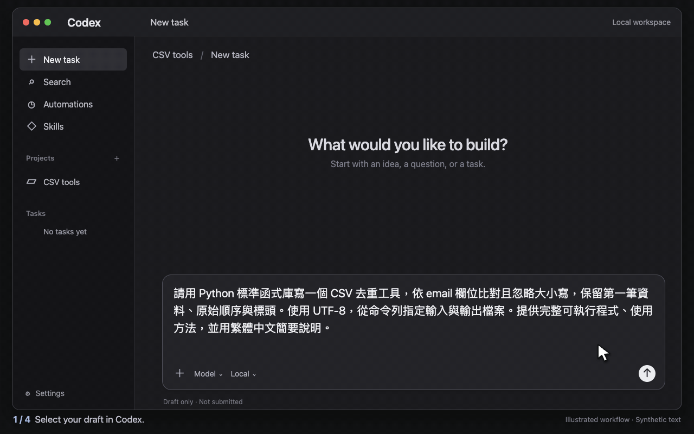

<p align="center"></p>

[English](../../README.md) · [简体中文（zh-CN）](README.zh-CN.md) · **繁體中文（zh-TW）** · [Español](README.es.md) · [Français](README.fr.md) · [Deutsch](README.de.md) · [Português](README.pt.md) · [Italiano](README.it.md) · [Русский](README.ru.md) · [Türkçe](README.tr.md) · [Nederlands](README.nl.md) · [Polski](README.pl.md) · [Українська](README.uk.md) · [日本語](README.ja.md) · [한국어](README.ko.md) · [हिन्दी](README.hi.md) · [বাংলা](README.bn.md) · [Bahasa Indonesia](README.id.md) · [Tiếng Việt](README.vi.md) · [ไทย](README.th.md) · [தமிழ்](README.ta.md) · [తెలుగు](README.te.md) · [मराठी](README.mr.md) · [العربية](README.ar.md) · [اردو](README.ur.md) · [فارسی](README.fa.md) · [Kiswahili](README.sw.md) · [ਪੰਜਾਬੀ](README.pa.md) · [Filipino](README.fil.md)

# PromptFinch

**選取。潤飾。貼上。**

PromptFinch 是適用於寫作、程式開發、研究、摘要與規劃的 Prompt 編輯與優化工具。將以你慣用語言寫下的粗略需求，整理成讓目標模型更容易執行的指令。優化器會要求模型釐清目標、輸入與限制，按需要安排步驟、處理關鍵資訊缺口，並從原始需求推導檢查方式。已經清楚的需求應保持精簡；新增結構應有助於任務，不應擅自添加新要求。

**macOS App** 可作為手動工作台或選取助手：在相容應用程式中選取文字、按右鍵，在輔助操作選單選擇 **轉為英文 Prompt**，再於附近面板檢視結果。只按右鍵不會將文字傳送給模型。另有使用相同後端的**瀏覽器工作台與 HTTP API**。

Windows／Linux 桌面預覽版新增相同工作台，以及 Windows UI Automation／Linux X11 的實驗性右鍵附加選單。Wayland 可使用手動輸入及剪貼簿匯入，沒有全域右鍵選單。詳見[桌面版支援指引（英文）](../desktop.md)。

PromptFinch 會編輯指令，不會執行指令描述的任務。它以保留需求、指定的答案語言與固定字串為設計目標。真正優化需要自行設定模型 API；沒有金鑰時，可用明確標示的 mock 模式試用操作流程，但不會翻譯或優化文字。

## 示範動圖



15 秒 Codex 桌面操作示意：選取粗略的 CSV 錯誤修正需求、按右鍵，在 PromptFinch 輔助操作選單選擇轉換，檢視補上專案檢查、聚焦修正與需求驗證步驟的英文 Prompt，再複製貼回 Codex。輔助選單由 PromptFinch 提供，並非 Codex 內建功能。介面、範例內容與優化結果皆為合成，未使用個人輸入；此動圖並非螢幕錄影或即時模型請求。

## 文件語言

最上方連結可切換 README 頁面。英文是原始版本；簡體中文（zh-CN）與繁體中文（zh-TW）包含完整參考內容。其他 26 個版本提供翻譯介紹，並連結至英文設定指引。這些連結切換文件，不會更改 App 語言。

macOS App 的**設定 → 介面語言**可選繁體中文（預設）、英文、日文與韓文。瀏覽器介面仍為繁體中文。新生成的優化說明與假設會使用原生介面語言；瀏覽器另有說明語言選單。切換語言不會重寫既有結果。

macOS App 生成英文 Prompt 指令。瀏覽器預設生成英文指令，也提供繁體中文選項。API 使用 `promptLanguage: "en"` 取得英文指令；省略時保留 `zh-Hant` 預設值。最終答案語言是原始 Prompt 中的另一項需求。工具接受 Unicode 輸入，但文件翻譯不代表每種語言的模型品質均已驗證。

[文件索引](../README.md) · [疑難排解](../troubleshooting.md) · [完整 API 參考](../api.md)

## 功能

- 接受原始 Prompt、任務類型，以及可選的下游目標模型名稱。
- 要求模型在保留任務意圖、限制與固定字串的前提下，改善需求清晰度與執行指引，而非只轉換語言。
- 產生可複製的 Prompt，並將優化說明與假設分開呈現；複製及貼回只會使用 Prompt 欄位。
- macOS App 提供手動輸入、選取操作、結果面板、模型設定、四種介面語言及可選的貼回功能。
- 處理空白輸入、長度限制、載入、取消與易懂的錯誤訊息。
- 可在明確標示的 mock 模式下免金鑰檢查流程，或由 Node.js 後端呼叫已設定的 OpenAI 相容模型。

任務類型包括通用、寫作、分析、程式開發、摘要與行銷；研究與規劃可選分析或通用。可選的**目標模型**只作為編輯 Prompt 的提示，不會切換後端生成模型；後端模型由 `LLM_MODEL` 設定。

## 系統需求

| 用途 | 需求 |
| --- | --- |
| 瀏覽器工作台／HTTP API | Node.js 22 或更新版本；不需第三方執行階段套件。 |
| macOS 原生 App | macOS 13 或更新版本作為編譯目標，並安裝 Node.js 22+ 執行階段。App 不內含 Node。 |
| 建置 macOS App | Apple Xcode Command Line Tools，包含 Swift 與 Apple 簽署工具；不需要完整 Xcode。 |
| 開發與瀏覽器測試 | `npm ci` 安裝開發依賴；Playwright 需要已安裝的測試瀏覽器。 |

原生建置會依 Node 程序架構產生 `arm64` 或 `x86_64`，不是 Universal Binary。已記錄的原生檢查是在 Apple Silicon 上執行；尚未在實體 Intel 裝置或最低 macOS 13 版本上驗證。

以下指令請在專案根目錄、macOS 或常見 Linux 環境提供的 POSIX shell 執行。

## 快速開始

取得原始碼後，選擇瀏覽器示範或 macOS App：

```sh
git clone https://github.com/JERMYSUEN/promptfinch.git
cd promptfinch
```

[v1.1.0 發行版](https://github.com/JERMYSUEN/promptfinch/releases/tag/v1.1.0) 提供 `PromptFinch-1.1.0-macos-arm64.zip`、`PromptFinch-source-v1.1.0.zip` 及 `SHA256SUMS`。App 下載適用於 Apple Silicon，採 ad-hoc 簽章、未經公證；需另外安裝 Node.js 22+。解壓縮後將 App 移至應用程式資料夾。設定及驗證範圍見[發行說明](../releases/v1.1.0.md)，也可從此原始碼工作目錄自行建置。[變更紀錄](../../CHANGELOG.md)區分先前快照；目前沒有自動更新或 Intel／Universal Binary 下載。

### 瀏覽器示範（不需 API 金鑰）

```sh
# Create a local configuration only if one does not already exist.
cp -n .env.example .env
npm start
```

開啟 [http://127.0.0.1:3000](http://127.0.0.1:3000)。若 `.env` 已存在，請先檢查內容，並設定 `OPTIMIZER_MODE=mock` 進行本機示範，不要覆寫原檔。執行服務不需要 `npm install`。

**Mock 輸出不會翻譯，也不會進行語意優化。**它是用來檢查輸入、載入、結果顯示及複製流程的範本，不會呼叫模型或將 Prompt 傳送給供應商。

瀏覽器的 Prompt 語言選單控制指令語言。原始需求中明確指定的答案語言仍會保留。

### 建置並安裝 macOS App

```sh
xcode-select --install  # Skip if Command Line Tools are already installed.
npm run setup:signing:mac
npm run build:mac
npm run install:mac
```

建置結果為 `build/PromptFinch.app`。安裝程式會將 App 放入使用者的 `~/Applications` 並開啟。無須另外啟動瀏覽器伺服器：App 會在 `http://127.0.0.1:3210` 啟動自己的後端。

安裝程式也會處理舊 App 名稱的遷移；詳見[更名說明](../branding.md)。

`setup:signing:mac` 是每台電腦各自執行一次的本機簽署身分設定。私密簽署金鑰會存放在登入鑰匙圈；macOS 可能要求確認存取。這有助於本機重建時維持輔助使用身分。這不是 Developer ID 簽署或公證，且不得發布簽署金鑰。若既有簽署設定無效，建置會停止，不會暗中取代身分。

若未選取模型設定，App 會使用 mock 模式。在「設定」中建立或選取模型設定檔、填入供應商設定並重新載入設定，也可在此選擇介面語言。若 App 找不到 Node，請在「設定」中選擇其執行檔。

也可在安裝時指定既有設定：

```sh
npm run install:mac -- --config .env
```

更多 macOS 設定請參閱目前以繁體中文撰寫的 [macOS 指南](../macos.md)。

## Windows 與 Linux 桌面預覽版

桌面版內含執行階段，直接在主程序使用共用優化器，不啟動本機 HTTP 伺服器；macOS 仍使用既有 Swift App。從原始碼啟動需要 Node.js 22.12+：

```sh
npm ci
node scripts/build-desktop-helpers.cjs
npm run desktop
```

Windows x64 上可建置安裝程式及 ZIP；Linux x64 上可建置 AppImage 及 tar.gz。執行 `npm run build:desktop`，結果在 `desktop-dist/<version>/`。已封裝的桌面版不需另裝 Node。Linux 建置依賴與啟動方式見[桌面版指引（英文）](../desktop.md)。

在相容軟體選取文字後按右鍵，再點附加選單的「轉為英文 Prompt」才會生成。擷取文字十秒後失效，不自動貼回或送出。Windows 支援取決於來源軟體的 UI Automation；Linux X11 讀取選取緩衝區，無法證明點擊位於反白範圍。Wayland 沒有此全域監聽功能。

取字不可用時，可自行複製後按「讀取剪貼簿」。`Ctrl+Alt+P` 匯入選取文字，`Ctrl+Alt+Shift+P` 匯入剪貼簿；快捷鍵不會生成。設定內會顯示右鍵監聽與快捷鍵狀態。介面提供繁體中文、英文、日文與韓文；建立模型設定範本、填入自己的金鑰，再選取檔案載入。新安裝預設示範模式；偏好設定只記錄語言及設定檔路徑。

## 模型設定

即時生成使用 **OpenAI 相容的 Chat Completions** 端點。後端會在 `LLM_BASE_URL` 後附加 `/chat/completions`。使用者需自行提供模型供應商帳號並負擔該帳號產生的費用。

PromptFinch 不內含或下載語言模型。`LLM_MODEL` 選擇透過 API 編輯 Prompt 的模型；可選的目標模型欄位只描述你打算貼上結果的模型。供應商模型名稱與帳號權限必須符合該供應商目前的 API 設定。

新設定可參考 [.env.deepseek.example](../../.env.deepseek.example)：

```dotenv
OPTIMIZER_MODE=live
LLM_API_KEY=YOUR_MODEL_API_KEY
LLM_BASE_URL=https://api.deepseek.com
LLM_MODEL=deepseek-flash
LLM_JSON_MODE=true
LLM_THINKING_MODE=disabled
LLM_TIMEOUT_MS=90000
HOST=127.0.0.1
PORT=3000
```

請在私人本機設定中以自己的金鑰取代 `YOUR_MODEL_API_KEY`。修改既有 `.env`，不要覆寫它。瀏覽器伺服器的設定變更後需重新啟動；Mac App 則需重新載入所選設定。

其他相容供應商可替換基本 URL、金鑰與模型識別碼。若供應商不接受 DeepSeek 思考參數，請將 `LLM_THINKING_MODE` 留空。若供應商不接受 JSON 模式，請設定 `LLM_JSON_MODE=false`；但它仍必須回傳優化器要求的有效 JSON。原生 Claude 或 Gemini 端點需要介接器或相容閘道，不能直接填入 Chat Completions URL。

不需驗證的本機相容服務可以 `LLM_API_KEY=local-only` 作為非機密佔位值，並設定該服務實際的基本 URL 與已載入模型名稱。這不會啟動或隨附本機模型。

| 變數 | 預設值 | 說明 |
| --- | --- | --- |
| `OPTIMIZER_MODE` | `mock` | `mock` 使用範本；`live` 呼叫模型。 |
| `LLM_API_KEY` | 空白 | 僅供後端使用的 Bearer 認證；即時模式必填。 |
| `LLM_BASE_URL` | `https://api.openai.com/v1` | 相容 API 基本 URL；不得含內嵌認證、查詢或片段。 |
| `LLM_MODEL` | 空白 | 供應商模型識別碼；即時模式必填。 |
| `LLM_JSON_MODE` | `true` | 傳送 `response_format: {type: "json_object"}`。 |
| `LLM_THINKING_MODE` | 空白 | 留空時不傳送；可用 `enabled` 或 `disabled`。 |
| `LLM_TIMEOUT_MS` | `45000` | 請求／回應逾時；整數範圍 10 至 180000 毫秒。 |
| `HOST` | `127.0.0.1` | 獨立伺服器的監聽位址。 |
| `PORT` | `3000` | 獨立伺服器連接埠。 |
| `ALLOWED_HOSTS` | 空白 | 反向代理的可選主機白名單，以逗號分隔，例如 `prompts.example.com,prompts.example.com:8443`。不接受萬用字元或完整 URL。 |

Mac App 無論所選設定檔中的值為何，都會將 `HOST` 與 `PORT` 設為 `127.0.0.1:3210`，並清空 `ALLOWED_HOSTS`。獨立瀏覽器伺服器可使用另一個連接埠。伺服器預設只接受本機名稱與非萬用監聽主機在實際連接埠上的請求；監聽 `0.0.0.0` 或 `::` 不會放行任意 Host。遠端網域與代理埠須明確列入白名單，不自動信任轉送主機標頭。

即時設定或供應商呼叫失敗時會回報錯誤，不會默默改用 mock 結果。`/api/config` 的 `ready` 表示設定已填妥，不代表已成功連上上游模型。

## 範例：Prompt 語言與答案語言

原始需求：

> 撰寫一段簡短邀請。保持 ACME-42 不變。請用西班牙文回答。

以下是示意優化結果，並非記錄到的模型回應：

```text
Write a brief invitation in Spanish. Preserve the exact text "ACME-42" wherever it occurs.
```

指令本身為英文，但要求下游模型撰寫的邀請仍為西班牙文。優化器回傳的是指令，而不是代為撰寫邀請。模型收到的指示包括保留明確需求與固定字串、標示合理假設並避免改變任務意圖；仍應檢查遺漏或誤譯。

## 多語輸入與涵蓋範圍

- 輸入、JSON 傳輸及原生選取均支援 Unicode。12,000 字元上限以 UTF-16 code unit 計算，與 JavaScript 及 Swift 的 UTF-16 視圖一致，並非可見字母或字素叢集數。超過上限會拒絕請求，不會截斷。選取範圍不能切開 surrogate pair。參閱 [JavaScript length](https://developer.mozilla.org/en-US/docs/Web/JavaScript/Reference/Global_Objects/String/length) 與 [Swift UTF16View](https://developer.apple.com/documentation/swift/string/utf16view)。
- 韓語諺文、俄語西里爾字母、由右至左文字、組合附加符號、連接符、表情符號及混合文字皆可輸入，不會正規化文字或按字母系統過濾。瀏覽器輸入欄會自動調整文字方向。文件涵蓋的語言與四種 macOS 介面語言是不同的範圍。
- 英文模式會分開處理指令語言與下游答案語言。模型必須保留明確答案語言要求、否定範圍、固定字串、變數、程式碼與 URL。若引號或程式碼中的固定字串僅因 NFC 正規化而被更動，後端會以有限規則修復明確可判定的情況。若字串被省略、翻譯或改為語意相近但拼法不同，後端無法重建；重要字串請自行檢查。
- [多語驗證紀錄](../multilingual-verification.md)記錄了傳輸檢查，以及使用 `deepseek-flash` 進行的 18 種語言、24 個即時模型合成案例，包含韓語／俄語的短、中、長案例。其中也記錄了一項不夠精確的日文優化說明，以及尚未測試的語言與宿主 App。這些樣本不保證新輸入或其他模型的翻譯品質。
- [跨語言對照驗證](../multilingual-parity-verification.md) 對 29 個 locale（28 種語言，中文分繁簡）使用同一組需求，另測答案語言推定、混語、長引文與條件範圍，分開記錄自動檢查、模型輸出覆核與剩餘限制。

## HTTP API

獨立伺服器預設為 `http://127.0.0.1:3000`。原生 App 管理的後端使用 `http://127.0.0.1:3210`。

```sh
curl --fail --silent --show-error http://127.0.0.1:3000/api/config

curl --fail --silent --show-error http://127.0.0.1:3000/api/optimize \
  -H 'Content-Type: application/json' \
  --data '{"prompt":"Write a brief invitation. Keep ACME-42 unchanged. Answer in Spanish.","task":"writing","targetModel":"","promptLanguage":"en"}'
```

| 請求欄位 | 行為 |
| --- | --- |
| `prompt` | 必填且不可空白；最多 12,000 個 UTF-16 code unit。 |
| `task` | `general`（預設）、`writing`、`analysis`、`coding`、`summary` 或 `marketing`。 |
| `targetModel` | 可選的下游模型提示；單行，最多 80 個 UTF-16 code unit。 |
| `promptLanguage` | `en` 表示英文指令；未提供時預設 `zh-Hant`。 |

成功時回傳 `prompt`、`improvements`、`assumptions`、`mode`、`generationModel` 與 `promptLanguage`。原文與結果對照會保留生成當時的原文，逐行標示文字改動；這不等於語意正確性驗證。重用結果時只複製 `prompt`；優化說明與假設是獨立的審閱備註。`notesLanguage` 支援 `zh-TW`（API 預設）、`en`、`ja`、`ko`，與 Prompt 指令及原文指定的答案語言分開。

API 會驗證輸入與模型回應結構、限制同時進行的優化請求，並回報設定、供應商、格式錯誤及逾時問題。取消操作會關閉上游請求；供應商端的處理及計費仍由供應商控制。

[完整 API 參考](../api.md)提供回應範例、設定就緒狀態、限制、狀態碼與取消行為。`LLM_TIMEOUT_MS` 是上游請求與格式重試共用的總時間預算；重試不會重新計時。

## macOS 操作流程

1. 開啟 App 手動工作台，輸入或貼上需求，選擇任務與可選目標模型，再產生英文 Prompt。
2. 檢視 Prompt 與分開顯示的備註。可複製 Prompt，或清空工作區以移除輸入與結果。
3. 使用選取操作時，依提示在系統設定中啟用「輔助使用」。在相容的輸入欄選取文字並按右鍵，再於輔助選單選 **轉為英文 Prompt**（按鈕文字會隨 App 語言切換）；結果會顯示在附近。宿主 App 原有的情境選單仍可使用。按取消、點擊其他位置、鍵盤輸入、切換 App 或等待 12 秒，都會關閉操作提示而不生成結果。只有在明確選擇操作後，助手才會再次檢查選取內容。也可使用選取按鈕。部分 Electron App 可能顯示啟用提示：等待約兩秒、重新選取文字後再試。
4. 其他入口包括預設的 Option-Command-P 快捷鍵、支援的 macOS 服務，以及明確的剪貼簿操作。宿主 App 必須提供可用的文字選取功能，因此不保證所有 App 都相容。
5. 可選的自動貼回需要可信任的非空選取範圍，並在送出貼上操作前重新核對來源 App、焦點欄位與選取文字。無法確認位置時，結果會複製供手動使用；只有文字資訊的選取仍可轉換，再自行貼上。狀態只回報已送出貼上操作，請確認來源文字，因為來源軟體可能忽略模擬按鍵。剪貼簿還原結果會在回呼完成後顯示。備份不完整、暫存或立即還原失敗時，會停止貼回且不自動複製，保留結果供自行複製。面板也提供複製及手動貼回。貼回不會送出聊天訊息，並可在設定中停用。Mock 結果不會貼回。

首次建立原生偏好設定時，選取按鈕、右鍵選單與自動貼回預設開啟。若要在取代可編輯原文前先檢視結果，請在設定關閉自動貼回；已辨識的終端來源不受此偏好影響，仍只複製結果。

關閉工作區視窗後，選取助手仍會在選單列運作；結束 App 則會停止由它啟動的後端。輔助選單是獨立且不會搶走焦點的操作面板，不會插入宿主 App 原有的情境選單。詳見[右鍵操作驗證](../context-menu-verification.md)。

### 僅更新原生後端

變更可信任的後端或瀏覽器程式碼後，可只更新已安裝 App 的外部後端，不必重建已簽署的原生執行檔：

```sh
npm run update:mac-backend
```

更新程式會先暫存並以 mock HTTP 檢查候選版本，正常關閉 App、檢查連接埠，再切換後端版本並重新啟動 App。若啟動失敗會嘗試復原。它不會更改所選模型設定，也不會終止無關的連接埠監聽程序。安裝重新建置的 App 會保留既有外部後端，不會自動選用較新的內附後端檔案。若要採用已安裝版本附帶的規則，請開啟**設定 → 使用此 App 隨附後端**。這是明確的本機操作，會暫存、驗證並啟動該 App 隨附的後端；失敗時會嘗試恢復原先版本。模型設定、Node 路徑與偏好會保留，不下載 GitHub 檔案，也不呼叫模型。切換前請先保留未完成的工作台文字。

既有安裝若同時更新原生與後端程式碼，請先更新可信任的原始碼工作目錄，再執行：

```sh
git pull --ff-only
npm run build:mac
npm run install:mac
npm run update:mac-backend
```

若只變更後端，更新原始碼後執行 `update:mac-backend` 即可。請保留此電腦已設定的穩定簽署身分；新電腦須先完成快速開始中的一次性簽署設定。更新程式是手動本機指令，不是自動下載服務。

## Terminal 與 CLI 選取

在 macOS Terminal 中使用 Claude Code 或 Codex CLI 時，選取畫面上的文字、按右鍵，再從附加選單點選「轉為英文 Prompt」。終端須提供可讀取的選取文字；只按右鍵不會生成或送出內容。

已辨識的終端來源採用**僅複製結果**的流程，即使其他輸入框已開啟自動貼回也一樣。檢視結果後，手動貼入指定的 CLI 輸入區，再自行送出。終端畫面的反白文字不等於可編輯的輸入範圍，因此不直接替換反白內容或向終端送出貼上操作。

[Terminal 指南](../terminal.md) 提供設定、替代入口與驗證範圍。使用者已確認 Apple Terminal 的附加選單與英文生成可用；Claude Code／Codex CLI 的個別設定，以及剪貼簿、手動貼入與取消等剩餘操作仍需手動驗收。

## 架構

```text
Native macOS workspace / selection result panel
  -> SwiftUI + AppKit client
  -> app-managed Node.js backend on 127.0.0.1:3210

Optional browser workspace / HTTP API client
  -> standalone Node.js backend on 127.0.0.1:3000

Either backend
  -> labeled mock template, or configured model provider
  -> prompt + separate improvements / assumptions
```

主要原始碼：

- [server.js](../../server.js)：HTTP API、靜態檔案、請求驗證與錯誤處理。
- [lib/optimizer.js](../../lib/optimizer.js)：設定、mock／即時模型介接器、編輯指示與回應驗證。
- [public/](../../public)：支援響應式版面的繁體中文瀏覽器工作台。
- [macos/Sources/](../../macos/Sources)：原生工作台、後端生命週期、選取、結果面板與貼回功能。
- [scripts/](../../scripts)：原生建置、本機簽署、安裝、後端更新與開發檢查。

## 隱私與資料處理

- API 金鑰由 Node.js 後端從本機設定讀取，不會暴露在前端程式碼或封裝進 App。目前金鑰以純文字環境檔保存；尚未整合 Keychain 金鑰儲存。
- 輸入、結果與說明在記憶體中處理，不使用資料庫或 Prompt 歷史紀錄。原生偏好設定（包括任務類型與目標模型提示）及設定路徑會儲存在本機。原生診斷記錄狀態中繼資料與長度，不記錄 Prompt 內容；分享日誌前仍須檢視 App／程序中繼資料。
- 即時模式會將請求與編輯指示傳送至已設定的模型供應商，並受該供應商的資料保留政策約束。Mock 不會呼叫模型。
- 瀏覽器介面不使用 Cookie、瀏覽器儲存、分析工具或遠端字型；重新載入會清空工作區。原生工作區可透過清除操作或結束記憶體工作階段清空。
- 啟用選取操作後，App 會監聽滑鼠事件並讀取可存取的文字選取內容。若安全的可編輯欄位提供非空選取範圍但沒有選取文字屬性，助手可能暫時讀取欄位值。超過 65,536 個 UTF-16 code unit 的值會被拒絕；只會回傳選取範圍，也不會記錄欄位內容。
- 複製、貼回及備援複製會使用系統剪貼簿。復原操作會先確認使用者沒有複製新內容。清空工作區不會刪除已複製到系統剪貼簿的文字。

這是供個人本機使用的工具，沒有帳號驗證或多使用者隔離。獨立伺服器支援部署設定，但公開部署需自行設定 HTTPS 與存取控制。遠端部署及 Docker 執行尚未驗證。

## 驗證結果與限制

[優化效果驗證紀錄](../optimization-value-verification.md)定義了 8 個合成案例，檢查翻譯之外的任務指引，以及清楚需求是否保持精簡。即時模型測試遇到供應商逾時與服務錯誤，尚未取得品質比較；示範結果不代表已證明模型或下游任務表現改善。

[先前的可靠性驗證](../reliability-verification.md)於 2026-10-09 通過 JavaScript 語法檢查、55 項 Node 測試、190 項原生檢查、10 項 Chrome 流程測試，以及 macOS 建置／簽章檢查。2026-10-11 的 Terminal 變更通過語法檢查、55 項 Node 測試、233 項原生檢查、README／文件連結檢查，以及 macOS 建置／簽章檢查，並完成新版安裝；這次原生變更未重跑瀏覽器流程測試。自動化測試使用 mock 或受控供應商，不代表真實模型的輸出品質。

使用者先前確認輔助選單出現時不會自動生成，且明確點擊一次即可取得英文結果。此版本在 Codex／Claude 中以實體滑鼠操作，以及完整的複製／貼回／取消行為仍需驗收。[選取驗證](../context-menu-verification.md)與[多語樣本審閱](../multilingual-verification.md)各自記錄不同的驗證範圍。

目前限制包括宿主 App 的選取支援、沒有 OCR、不能自訂全域快捷鍵、未內含 Node、沒有自動更新，以及沒有現成且經公證的安裝程式或 Universal Binary 發行版。Intel／最低 macOS 版本硬體、實體行動裝置、Docker 與遠端部署仍未驗證。實際語意品質仍需人工覆核；最新檢查與限制見[改善驗證紀錄](../improvement-verification.md)。

## 開發

```sh
npm ci
npm run check
npm run check:docs
npm test

# Browser checks: install the test browser once.
npx playwright install chromium
npm run test:ui

# Alternatively, use an installed Google Chrome.
PLAYWRIGHT_CHANNEL=chrome npm run test:ui

# macOS-only checks and native build.
npm run test:mac
npm run build:mac
```

在具備 Node.js 22+ 與 Xcode Command Line Tools 的 macOS 上執行 `npm run package:mac`，可產生公開用 Apple Silicon App ZIP 與來源 ZIP。它只複製明確列出的公開檔案，以 ad-hoc 簽章建置，不讀取真實 `.env` 或個人簽章設定。發行 manifest 記錄相對輸入路徑與 SHA-256；`SHA256SUMS` 列出下載檔案校驗碼。這項封裝不會公證 App 或發布到 GitHub。只需來源包時可執行 `npm run package:source`。

`npm run dev` 會以 Node watch 模式執行獨立伺服器。`npm run check:docs` 會檢查 README 導覽、翻譯結構與變更紀錄順序，不會認證翻譯準確度或模型品質。API 測試使用本機假模型服務；原生測試使用合成目標與具名測試剪貼簿。[GitHub 工作流程](../../.github/workflows/check.yml)會執行 JavaScript／文件檢查、Node 測試與 macOS 原生檢查、公開封裝與解壓後驗證，不會發布發行檔案。瀏覽器測試目前在本機執行；特定提交的結果請查看 [GitHub Actions](https://github.com/JERMYSUEN/promptfinch/actions)。

## 貢獻與授權

開發慣例請參閱 [CONTRIBUTING.md](../../CONTRIBUTING.md)。歡迎修正翻譯，以及使用可分享合成輸入的可重現問題報告。請勿在貢獻中放入 API 金鑰、本機環境檔、私人 Prompt、剪貼簿內容或個人簽署資料。

PromptFinch 使用 [MIT License](../../LICENSE)。模型供應商帳號及任何模型費用由各使用者自行負責。
